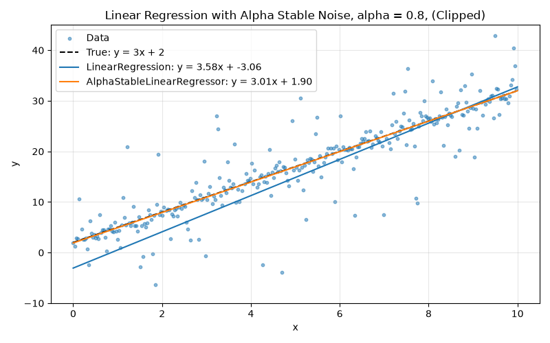
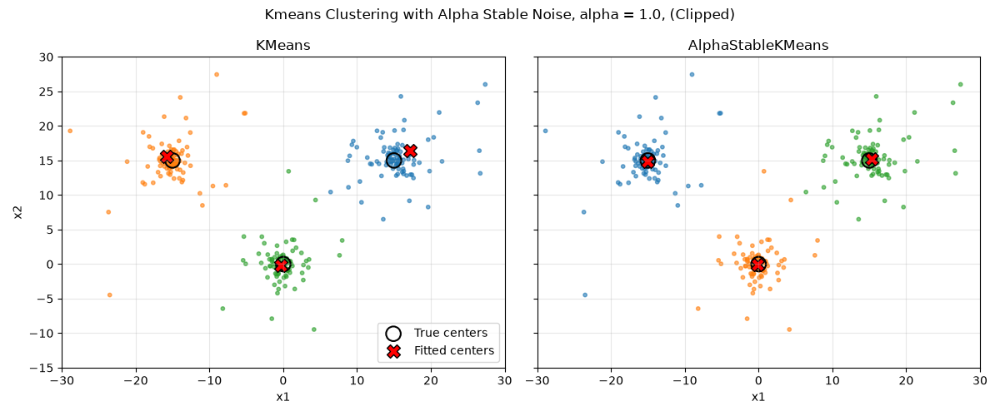

# AUB-HTP

**⚠️ ATTENTION ⚠️ You are currently viewing the unreleased development version of the AUB-HTP codebase. Please find the latest released version of the AUB-HTP codebase v1.1.X [here](https://github.com/AUB-HTP/AUB-HTP/tree/maintenance/v1.1).**

[](https://github.com/aub-htp/AUB-HTP/actions/workflows/run-tests.yml)

[](https://arxiv.org/abs/2606.28530)

American University of Beirut's Heavy Tails Package (AUB-HTP) is a modern python toolkit for analyzing Alpha Stable Distributions (also called Levy-Stable distributions)

AUB-HTP includes:
- **SciPy compatible** Alpha Stable Distribution:
    - [`aub_htp.alpha_stable.pdf` Univariate Alpha Stable Probability Density Function (PDF)](#Univariate-Probability-Density-Function-PDF-Generation)
    - [`aub_htp.alpha_stable.rvs` Univariate Alpha Stable Random Number Generator (RNG)](#Univariate-Random-Variable-Sampling-RVS)
    - [`aub_htp.multivariate_alpha_stable.rvs`: Multivariate Alpha Stable Random Variable Sampling](#Multivariate-Random-Variable-Sampling-RVS)
- **Scikit-learn compatible** [`AlphaStableLinearRegressor` Linear regressor for Alpha Stable distributed data](#Linear-Regressor-For-Alpha-Stable-Distributed-Data)
- **Scikit-learn compatible** [`AlphaStableKMeans` Kmeans clustering for Alpha Stable distributed data](#Kmeans-Clustering-For-Alpha-Stable-Distributed-Data)
- Robust Alpha Stable statistics:[^1]
    - `alpha_power`
    - `alpha_location`

## Installation

```commandline
pip install aub-htp
```

For alternative installation methods (uv, conda, poetry), see the [installation guide](https://aub-htp.github.io/AUB-HTP/install).

## Usage

### Univariate Alpha Stable Distributions

#### Univariate Probability Density Function (PDF) Generation
```python
import aub_htp as ht
import numpy as np

x = np.linspace(-10, 10, 100)
y = ht.alpha_stable.pdf(x, alpha = 0.4, beta = 0.8, loc = 2, scale = 3)
```

You can also switch between [parametrizations](https://en.wikipedia.org/wiki/Stable_distribution#Parametrizations) `S0` and `S1` (default).
```python
import aub_htp as ht
import numpy as np

x = np.linspace(-10, 10, 100)
ht.alpha_stable.with_parametrization("S0")
y = ht.alpha_stable.pdf(x, alpha = 0.4, beta = 0.8, loc = 2, scale = 3)
```


#### Univariate Random Variable Sampling (RVS)
```python
import aub_htp as ht

sample = ht.alpha_stable.rvs(alpha = 0.4, beta = 0.8, loc = 2, scale = 3)
print(sample)
# --------------------------------------------------------------------
# 32712.16830783209
```

```python
import aub_htp as ht

ht.alpha_stable.with_parametrization("S0")

samples = ht.alpha_stable.rvs(alpha = 0.4, beta = 0.8, loc = 2, scale = 3, size = (2,5), random_state = 38)
print(samples)
# --------------------------------------------------------------------
# [[  3.23516232   2.69285354   6.42379299   2.47262474   0.9449036 ]
#  [259.96755723   0.6227459  118.69956139   3.63961872   3.45083368]]
```


### Multivariate Alpha Stable Distributions

#### Multivariate Random Variable Sampling (RVS)

Sampling from a multivariate alpha stable distribution requires knowledge of the underlying mathematical spectral measure you wish to sample against.
AUB-HTP's standard library of spectral measure samplers includes:
- Isotropic Spectral Measure Sampler
- Elliptic Spectral Measure Sampler
- Discrete Spectral Measure Sampler
- Mixed Spectral Measure Sampler
- Univariate Spectral Measure Sampler

Example 0: Sampling from the standard 2d isotropic spectral measure.
```python
import aub_htp as ht

samples = ht.multivariate_alpha_stable.rvs(alpha = 1.2, spectral_measure_sampler = "standard_isotropic_2d")
print(samples)
```


Example 1: Sampling from an isotropic spectral measure.
```python
import aub_htp as ht
from aub_htp.random import IsotropicSampler

alpha = 1.2
sampler = IsotropicSampler(number_of_dimensions= 2, alpha = alpha, gamma = 2)

samples = ht.multivariate_alpha_stable.rvs(alpha = alpha, spectral_measure_sampler = sampler, size = 10)
print(samples)
```

Example 2: Sampling from a mixed spectral measure.

```python
import aub_htp as ht
from aub_htp.random import IsotropicSampler, EllipticSampler, DiscreteSampler, MixedSampler

alpha = 0.6

isotropic = IsotropicSampler(number_of_dimensions = 2 , alpha = alpha, gamma = 2)
elliptic = EllipticSampler(number_of_dimensions = 2, alpha = alpha, sigma = [[10, 2], 
                                                                             [2, 50]])
discrete = DiscreteSampler(alpha = alpha, positions = [[0, 1], [-1, 0]],  weights = [0.2, 0.8])

mixed = MixedSampler(spectral_measures = [isotropic, elliptic, discrete], weights = [0.4, 0.4, 0.2])

samples = ht.multivariate_alpha_stable.rvs(alpha = alpha, spectral_measure_sampler = mixed, shift = [4, 2], size = 10)

print(samples)
```

#### Custom Spectral Measures

You can also extend the standard library collection by extending the base class `BaseSpectralMeasureSampler`. 

**Important Note**: When sampling an alpha stable vector against your custom defined spectral measure with $alpha \ge 1$, your custom spectral measure $\Lambda$ has to uphold the following property:
$$\int_{\mathbb{S}^{d-1}}s\Lambda(ds)=0$$

Example: Butterfly Spectral Measure Sampler
```python
import aub_htp as ht
from aub_htp.random import BaseSpectralMeasureSampler
import numpy as np

class ButterflySampler(BaseSpectralMeasureSampler):
    def sample(self, number_of_samples: int, random_state = None):
        p = np.random.rand(number_of_samples)
        theta = np.empty(number_of_samples)

        mask = p <= 0.5
        theta[mask] = np.random.uniform(-np.pi / 4, np.pi / 4, size=mask.sum())
        theta[~mask] = np.random.uniform(
            3 * np.pi / 4,
            5 * np.pi / 4,
            size=(~mask).sum()
        )

        x = np.cos(theta)
        y = np.sin(theta)

        return np.column_stack((x, y))

    def dimensions(self) -> int:
        return 2

    def mass(self) -> float:
        return 1.0

samples = ht.multivariate_alpha_stable.rvs(alpha = 0.8, spectral_measure_sampler=ButterflySampler(), size = 10000)
```


### Linear Regressor For Alpha Stable Distributed Data

`AlphaStableLinearRegressor` is built for data with alpha stable noise, where ordinary least squares would get thrown off by outliers.

Example: Linear regression with alpha-stable noise.

```python
import aub_htp as ht
import numpy as np
from aub_htp.machine_learning import AlphaStableLinearRegressor
from sklearn.linear_model import LinearRegression

x = np.linspace(0, 10, 320)
noise = ht.alpha_stable.rvs(alpha = 0.8, beta = 0, loc = 0, scale = 1, size = 320, random_state = 38)
y = 3 * x + 2 + noise
X = x.reshape(-1, 1)

ols = LinearRegression().fit(X, y)
alpha_stable = AlphaStableLinearRegressor(alpha = 0.8).fit(X, y)

print(f"LinearRegression:           y = {ols.coef_[0]:.2f}x + {ols.intercept_:.2f}")
print(f"AlphaStableLinearRegressor: y = {alpha_stable.coef_[0, 0]:.2f}x + {alpha_stable.intercept_[0]:.2f}")
# --------------------------------------------------------------------
# LinearRegression:           y = 3.58x + -3.06
# AlphaStableLinearRegressor: y = 3.01x + 1.90
```



### Kmeans Clustering For Alpha Stable Distributed Data

`AlphaStableKMeans` is built for clustering data with alpha stable noise, where standard Kmeans gets pulled around by outliers.

Example: Clustering three groups of points with alpha-stable noise.

```python
import aub_htp as ht
import numpy as np
from aub_htp.machine_learning import AlphaStableKMeans
from sklearn.cluster import KMeans

true_centers = np.array([[0, 0], [15, 15], [-15, 15]])
X = np.vstack([
    center + ht.multivariate_alpha_stable.rvs(alpha = 1.0, spectral_measure_sampler = "standard_isotropic_2d", size = 100, random_state = 38 + i)
    for i, center in enumerate(true_centers)
])

kmeans = KMeans(n_clusters = 3, n_init = 10, random_state = 38).fit(X)
alpha_stable = AlphaStableKMeans(n_clusters = 3, alpha = 1.0).fit(X)

print("KMeans centers:")
print(np.round(kmeans.cluster_centers_, 2))
print("AlphaStableKMeans centers:")
print(np.round(alpha_stable.cluster_centers_, 2))
# --------------------------------------------------------------------
# KMeans centers:
# [[ 17.21  16.43]
#  [-15.75  15.56]
#  [ -0.33  -0.15]]
# AlphaStableKMeans centers:
# [[-15.07  14.91]
#  [ -0.2   -0.13]
#  [ 15.33  15.25]]
```



### Papers and Further Readings
[Information Measures, Inequalities and Performance Bounds for Parameter Estimation in Impulsive Noise Environments](https://ieeexplore.ieee.org/document/8231219) (2018)
[^1]: [Information Measures, Inequalities and Performance Bounds for Parameter Estimation in Impulsive Noise Environments](https://ieeexplore.ieee.org/document/8231219) (2018)

#### Preprints
[Density Functions and Random Number Generators of α-Stable Distributions](https://arxiv.org/abs/2606.28530) (2026)
[^2]: [Density Functions and Random Number Generators of α-Stable Distributions](https://arxiv.org/abs/2606.28530) (2026)

[Heavy-Tailed Principal Component Analysis](https://arxiv.org/abs/2603.11308) (2026)
[^3]: [Heavy-Tailed Principal Component Analysis](https://arxiv.org/abs/2603.11308) (2026)

#### Other References
[Univariate Stable Distributions Models for Heavy Tailed Data By John P. Nolan](https://doi.org/10.1007/978-3-030-52915-4) (2020)
[^4]: [Univariate Stable Distributions Models for Heavy Tailed Data By John P. Nolan](https://doi.org/10.1007/978-3-030-52915-4) (2020)

[Multivariate elliptically contoured stable distributions: Theory and estimation](https://www.researchgate.net/publication/241359457_Multivariate_elliptically_contoured_stable_distributions_Theory_and_estimation) (2013)
[^5]: [Multivariate elliptically contoured stable distributions: Theory and estimation](https://www.researchgate.net/publication/241359457_Multivariate_elliptically_contoured_stable_distributions_Theory_and_estimation) (2013)

[Integral representations of one-dimensional projections for multivariate stable densities](https://www.sciencedirect.com/science/article/pii/S0047259X08001346) (2009)
[^6]: [Integral representations of one-dimensional projections for multivariate stable densities](https://www.sciencedirect.com/science/article/pii/S0047259X08001346) (2009)

[Multivariate Stable Densities as Functions of One Dimensional Projections](https://www.sciencedirect.com/science/article/pii/S0047259X98917559) (1998)
[^7]: [Multivariate Stable Densities as Functions of One Dimensional Projections](https://www.sciencedirect.com/science/article/pii/S0047259X98917559) (1998)

